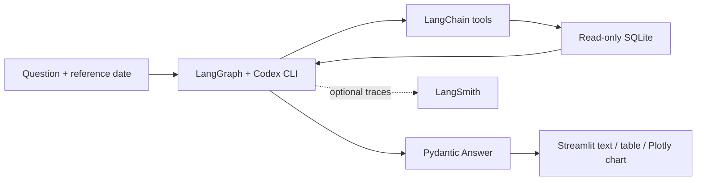

# Aurora Hockey Analytics — Week 1

A small learning project: ask questions about a fictional hockey season and get text, tables or charts. Codex selects LangChain tools; SQL computes the figures; Pydantic validates the response; Streamlit renders it.

## Setup

Use **Python 3.10+ (3.12 recommended)**. From the repository root:

```bash
cd Week1
python3.12 -m venv .venv
source .venv/bin/activate
python -m pip install -r requirements-lock.txt
cp .env.example .env
python -m hockey.data
streamlit run app.py
```

On Windows activate with `.venv\Scripts\activate`. Open the localhost URL printed by Streamlit.

Start with **Offline demo**. It supports four fixed examples, calls Python directly and does not use an LLM. For free-text queries select **Codex agent**. This uses your saved Codex CLI login; no Anthropic or OpenAI API key is required.

In the same terminal that starts Streamlit:

```bash
codex --version
codex login status
# If not logged in:
codex login
```

Use a recent Codex CLI supporting `exec`, `--output-schema`, `--ignore-user-config`, `--ignore-rules` and `--ephemeral`. The app reads `CODEX_BIN` directly from `Week1/.env` on each query, then checks PATH and the platform-matching VS Code extension binary. If discovery still fails, set `CODEX_BIN` in `.env` to its absolute executable path. For the Codex VS Code extension you can locate it with:

```bash
find "$HOME/.vscode/extensions" -path '*/bin/*/codex' -type f
```

Set `CODEX_MODEL` optionally to a model available to your login. Blank uses the CLI's built-in default. The app ignores personal CLI configuration and rules to avoid loading unrelated MCP servers or project customizations, but retains your saved authentication (including `CODEX_HOME` if set). Each decision runs in a temporary directory with a read-only sandbox and ephemeral session. Account limits apply. `CODEX_TIMEOUT_SECONDS` defaults to 120 per decision; complex queries can take several decisions. Restart Streamlit after changing `.env`.

If `.env` already exists, update it with the Codex settings from `.env.example`; old `ANTHROPIC_*` entries are unused. Do not commit `.env` or Codex authentication files.

For LangSmith tracing set `LANGSMITH_TRACING=true`, add `LANGSMITH_API_KEY`, and restart Streamlit. Open `week1-hockey` to inspect the Python wrapper, LangGraph nodes, and LangChain tool spans. Codex's internal model/token events are not native LangSmith model spans. Questions, tool arguments and synthetic results can be sent to LangSmith when enabled. Offline mode generates no agent traces.

## Questions to try

- Which home games are under 70% sold?
- Revenue by price tier for the next 5 games
- Chart attendance vs. opponent win rate
- Suggest a discount for the weakest-selling game
- In Codex mode: Show the schedule from 2026-10-01 to 2026-10-31.
- In Codex mode: Compare home games 7 and 8, including revenue and seat occupancy.

Use the default reference date **2026-10-09**. The data covers October–December 2026. Dates after the season correctly produce no upcoming games. “Next five games” in ticket analytics means five upcoming scheduled **home** games, because away inventory is not modeled.

## How it works



A small `StateGraph` implements the ReAct loop: Codex decision → LangChain tool execution → Codex decision. The CLI receives the question, tool descriptions/argument schemas and previous tool results through stdin. Its `--output-schema` response requests tools or supplies the final Pydantic `Answer`. Python validates tool names and arguments before invoking the registered `@tool` functions. The loop is limited to six decisions with up to eight tools per decision.

This is a CLI bridge rather than a LangChain chat-model provider, so it uses a custom graph instead of `create_agent` / `ToolStrategy`. Each final answer has a type, title, explanation and rows of named cells; charts specify x/y columns and chart kind. Expand **Tool calls** and **Structured output JSON** to inspect the requests and render contract.

## Files and learning order

1. `hockey/data.py`: seeded random data, three CSV exports and SQLite constraints.
2. `hockey/analytics.py`: parameterized SQL, revenue, weighted occupancy, date filtering and discount rule.
3. `hockey/tools.py`: eight small functions decorated with `@tool`; descriptions tell Codex when to use them.
4. `hockey/schema.py`: Pydantic output contract and chart column validation.
5. `hockey/agent.py`: model, instructions, tools, structured output and invocation.
6. `app.py`: UI and renderer. `hockey/demo.py` contains the clearly separate offline examples.
7. `tests/`: data/analytics tests and dependency-based UI/tool/schema smoke tests.

For practice: add an `unsold_seats(game_id)` tool, test it against capacity minus sold, register it in `TOOLS`, and ask Codex to compare unsold inventory. Then add a line chart of revenue by date. Inspect traces before changing prompts.

## Data definitions and limits

All teams, games and statistics are fictional. Aurora is the featured team. Each game stores `home_team` and `away_team`; the matchup label uses “Away team at Home team,” so “Lake Wolves at Aurora” means Aurora hosts Lake Wolves. Charts include matchups in labels or hover details. There are 24 games, 16 at home, three seat tiers per home game, and six completed games. Scheduled games have null goals/shots/results. Opponent win rate is a synthetic pre-season snapshot, not computed from these games.

Revenue is booked gross ticket revenue in USD (`price * sold`), excluding fees/refunds. Sold percentage uses total sold / total capacity, not an average of tier percentages. Tickets sold is an **attendance proxy**, not actual turnstile attendance. Discount advice chooses the weakest-selling upcoming home game and its weakest tier, then suggests 15% below 60% sold or otherwise 10%. This is an illustrative rule with no demand forecasting or revenue guarantee, and changes no prices.

The Python tool dispatcher only accepts the supplied read-only tools. Codex is instructed to request these tools rather than use its native shell; its subprocess uses a read-only sandbox. There is intentionally no arbitrary pandas execution or model-written SQL tool in this beginner starter. Each question is independent; the UI does not maintain conversational memory.

Regenerate with `python -m hockey.data --seed 42 --start 2026-10-01`. This replaces generated data files. CSVs are included for review; SQLite is ignored and regenerated locally.

## Validation

```bash
python -m unittest discover -s tests -v
python -m pip freeze > requirements-lock.txt
```

All **18 automated tests pass** with Python 3.12.15. The tests cover analytics, all offline UI flows, Codex mode rendering with a mocked backend, the CLI bridge and the bounded LangGraph tool loop. Mocked tests need no Codex login or network. A live Codex query requires a working CLI login, network access and available account usage. Live queries using the existing ChatGPT login verified home games under 70% sold (table), revenue for the next five home games (15-row table), the weakest-selling game discount (text advice), and attendance versus opponent win rate (16-point scatter chart). Each selected the expected analytics tool. LangSmith tracing has not been verified with a live LangSmith key.

Dependency ranges are declared in `requirements.txt`; `requirements-lock.txt` records the dependency versions with the Anthropic packages removed. Install the lock for a reproducible environment. If you regenerate it in an older environment, uninstall unused Anthropic packages first.

## Git submission and short video

Follow `demo/VIDEO_GUIDE.md` to record a 2–3 minute walkthrough. The repository includes the recording script; a screen recording must be made from your running app. Upload the MP4 to your assignment portal or attach an accessible video link in `demo/SUBMISSION.md`. Do not include your keys on screen.

From the repository root, review before committing:

```bash
git status --short
git add Week1
git diff --cached --stat
git commit -m "Add Week 1 hockey analytics starter"
# Push to your configured remote when ready:
git push
```

The nested `.gitignore` excludes `.env`, the virtual environment, local database and large videos. If your course requires a small MP4 in Git, explicitly add only that file with `git add -f Week1/demo/demo.mp4`; for larger files use the assignment portal or Git LFS.

## References

- [LangChain agents](https://docs.langchain.com/oss/python/langchain/agents)
- [LangGraph workflows](https://docs.langchain.com/oss/python/langgraph/workflows-agents)
- [Codex CLI non-interactive mode and schemas](https://learn.chatgpt.com/docs/non-interactive-mode)
- [LangSmith tracing](https://docs.langchain.com/langsmith/trace-with-langchain)
