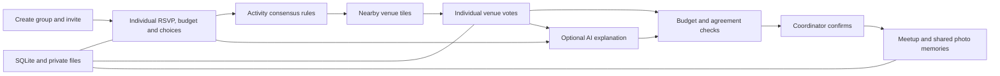

# After Hours — Week 2

A local Streamlit learning project that helps friends choose an affordable meetup and keep the memories. The current experience has four pages: **Home**, **Your group**, **Our adventures**, and **Help**. Week1 is a separate project.

## The current workflow

1. **Start a group.** Create your app account or sign in with Google, then enter a US meetup ZIP code and activity ideas, then choose a date, local time, duration and proposed per-person budget. The creator is coordinator; there is no coordinator election.
2. **Invite friends.** Copy the event link from **Share this event**. Each friend joins with their own name. Text preparation opens a draft in your messaging app; you review and send it yourself. Invitation links expire after seven days and can be replaced by the coordinator.
3. **Save individual choices.** Each person answers Can join, Maybe or Cannot join, selects multiple activities, types their own maximum spend (including cents, with a minimum of $15 per person) and adds preferences or needs. Responses remain editable until activity agreement. Maybe remains tentative.
4. **Find common ground.** After every member responds, the optional assistant explains a shared activity and compromises. Every attending or tentative member must consent to real AI analysis. The coordinator can agree only on an activity accepted by every definite attendee. AI is not required to continue.
5. **Choose a venue on the same page.** Search nearby venues for the agreed activity, review the tiles and add independently checked prices/ratings with a source where available. Open venue voting. Every attending or tentative member votes on each venue. The assistant can recommend a listed eligible option using supplied facts, budgets and votes.
6. **Confirm together.** The coordinator confirms only after all available/tentative members have voted and every definite attendee marks the chosen venue Works for me. Known cost cannot exceed the event budget or any definite attendee’s saved budget. Unknown cost remains unknown and requires checking; it does not prove affordability. Venue confirmation does not make a reservation or send booking texts.
7. **Make memories.** After the outing, the coordinator marks it completed in **Our adventures**. Any member can upload photos and captions for the group. The open gallery refreshes about every five seconds. Coordinators can also add an already-completed past adventure without a places connection.
8. **Leave when needed.** **Group settings → Leave this group** revokes access. A coordinator hands over to an active member if others remain. Uploaders can optionally delete their own memories during departure; otherwise shared memories remain with the group. An unfinished plan resets for renewed agreement; a confirmed venue remains in history.

The shared spending ceiling is the lower of the proposed event budget and all definite attendees’ personal limits. Older responses inherit the proposed budget until updated. Tentative members’ budgets are shown to the assistant but do not count as confirmed attendance. Food, fees, transport and extra costs still need a human check.

## Run locally

Python 3.12 is recommended. From the repository root:

```bash
cd week2
python3.12 -m venv .venv
source .venv/bin/activate
python -m pip install -r requirements-lock.txt
cp .env.example .env
streamlit run streamlit_app.py --server.port 8502 --server.address 127.0.0.1
```

If the environment already exists:

```bash
cd week2
.venv/bin/streamlit run streamlit_app.py --server.port 8502 --server.address 127.0.0.1
```

Open <http://127.0.0.1:8502>. The terminal stays occupied while Streamlit runs; this is normal. No server is started by the demo-generation or testing commands.

## Try the Dallas demo

Select **Try the Dallas demo** on Home. Four fictional friends already have sample responses and different budgets. The coordinator can run **Find our common ground**, agree on an activity, search fictional venue tiles, open voting and switch among friends using **Demo: view as a friend**. Have every available/tentative friend vote, return to the coordinator, request a sample venue recommendation and confirm a venue accepted by definite attendees. Then mark the outing completed and add a memory in Our adventures.

Demo recommendations use offline rules, not LLM calls. Demo names, prices, ratings and addresses are synthetic. No real discovery, messages or reservations happen. Start a fresh demo from Home to reset it. Real groups cannot switch identities.

## Host connections

Members never create API keys. The host configures optional services once in the ignored `.env`.

| Connection | Current purpose |
|---|---|
| `GEOAPIFY_API_KEY` | ZIP-based nearby place tiles; hours/address/site where available |
| Codex CLI saved login | Optional activity and venue recommendations after participant consent |
| `CODEX_BIN` | Optional path to the Codex executable |
| `REFEREE_DATA_DIR` | Private directory for SQLite and uploaded photo files |

Nearby searches resolve the ZIP through Zippopotam.us, then search Geoapify within roughly **10 straight-line miles of the ZIP center**. Category selections and chosen tiles are retained across searches for that ZIP. Requests run on explicit actions, use bounded cached results, and show provider errors. Missing keys, quotas or unavailable services do not silently produce invented places. Reviews, price estimates and hours may be unavailable; no LLM invents them.

The current simple flow uses one shared meetup area. It does **not** calculate a 50-mile limit from every member, automatically verify availability, dietary/access requirements or book a table. Add important needs in the response and check them before confirming.

For real AI:

```bash
codex login status
# If needed:
codex login
```

The host CLI reuses its saved login. It runs with a structured Pydantic schema, temporary working directory, read-only sandbox, disabled shell/web tools and an environment that excludes app secrets. No separate OpenAI API key is required. Account access and network connectivity are still needed.

Only aliased responses, saved budgets and supplied venue facts are sent for recommendations. Membership keys, photos and contact details are excluded. Python validates the selected ID and rejects results when responses or votes changed during analysis. An LLM cannot finalize, book or send messages. Personal tracing is disabled. AI remains optional.

## Architecture



| File | Responsibility |
|---|---|
| `streamlit_app.py`, `referee/ui.py` | Four main pages, navigation, shared gallery and Help |
| `referee/simple.py` | Group plans, invitations, individual responses and budget ceiling |
| `referee/common_ground.py` | Optional activity explanation and consensus |
| `referee/nearby.py`, `referee/providers.py` | ZIP lookup and nearby venue adapters |
| `referee/meetup.py` | Venue rounds, ballots, suggestions and final agreement |
| `referee/store.py` | Group-scoped persistence and private photo storage |
| `referee/membership.py` | Departure and coordinator transfer |
| `referee/codex.py`, `referee/security.py` | Restricted AI invocation and security helpers |
| `scripts/build_demo.py` | Synthetic captioned video generator and source watcher |

Original LangGraph parallel advocates, Neo4j matching, detailed discovery, reservation handoff and opt-in Twilio SMS remain learning modules for **older detailed groups**. They are not the default workflow. The simple group does not sync to Neo4j or send booking notifications. Mem0 is not connected. Do not describe these legacy modules as active simple-flow features.

## Enable creator accounts (host setup)

Real event creation is blocked until Google sign-in is configured. The Dallas demo and guest invitation joining remain available without account setup. The first successful Google sign-in creates the local app account; users do not create another password.

1. In Google Auth Platform, configure the app branding and audience, then create a **Web application** OAuth client. During testing, add the Google accounts allowed to sign in.
2. Register this exact callback: `http://127.0.0.1:8502/oauth2callback`. Use the same hostname when opening the app; localhost and 127.0.0.1 must not be mixed in this login flow.
3. Copy `.streamlit/secrets.toml.example` to `.streamlit/secrets.toml`. Fill in the Google client ID and client secret, and replace the cookie-secret placeholder with a long random value generated locally, for example with `python -c "import secrets; print(secrets.token_urlsafe(48))"`.
4. Restart Streamlit. Choose **Plan something good → Create account / sign in with Google**. After Google returns to Home, open Your group to create an event or reopen a saved meetup.

The secrets file is ignored by Git. Do not paste credentials into chat. The authentication dependencies are included in the requirements and installed in the local environment. Account linking and recovery are tested with simulated trusted identities; a live Google callback still needs your own host credentials and browser verification.

See the [official Streamlit Google authentication guide](https://docs.streamlit.io/develop/tutorials/authentication/google) for provider registration details. This configures creator login; it does not deploy the app or remove the localhost restriction.

## Storage, accounts and privacy

SQLite saves groups, memberships, responses, votes and memories automatically. Uploaded photos live alongside it; back up both together. Image uploads are validated, resized/re-encoded and stripped of EXIF. They are rendered through membership-checked gallery code. Members see the group’s shared memories, while only the uploader can delete their own entries. Photos are not sent to an LLM. Files and secrets are excluded from Git.

**This remains a local prototype.** Event creators sign in through Google and reopen linked groups under Your saved meetups. Accounts use the verified provider subject, not an email typed into a form. Passwords and OAuth tokens are not stored in SQLite. Reopening a group replaces its prior browser membership key, so a previous open membership session becomes invalid. Signing out clears the current app session. Older groups are not linked automatically by matching names or email. Invitation guests still use prototype membership sessions and should keep that browser session open; existing access keys can restore those memberships. Invitation links create new membership, not recovery. Secure remote hosting and private cloud media remain pending.

Localhost links work only on the app computer. A hosted URL variable alone does not provide hosting or authentication. The app intentionally rejects non-local binding. Before using real personal information remotely, extend verified accounts to guests and complete authorization, persistent private media and deployment-specific security checks. See `SECURITY_REVIEW.md` for the recorded assessment, including limitations; this is not a guarantee against every vulnerability.

## Tests and demonstration video

```bash
cd week2
.venv/bin/python -m pytest -q
.venv/bin/python scripts/build_demo.py
# Keep rebuilding while editing:
.venv/bin/python scripts/build_demo.py --watch
```

The captioned, silent `demo/walkthrough.mp4` is shown in **Help → Architecture**. It is a generated slide walkthrough using synthetic decisions, not a browser recording. Its manifest records the source fingerprint. The watcher rebuilds when tracked application sources change while it is running; it does not run automatically in the background. GitHub Actions tests and builds a downloadable video artifact on relevant pushes, without auto-committing it.

Before submitting, keep `.env`, local databases, photos, virtual environments and login credentials out of Git. Review `.gitignore` and staged files. Commit only code, tests, documentation and the synthetic demonstration assets you intend to share.
